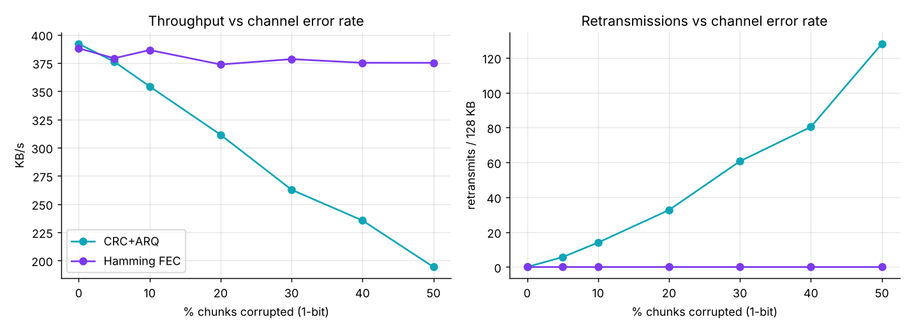
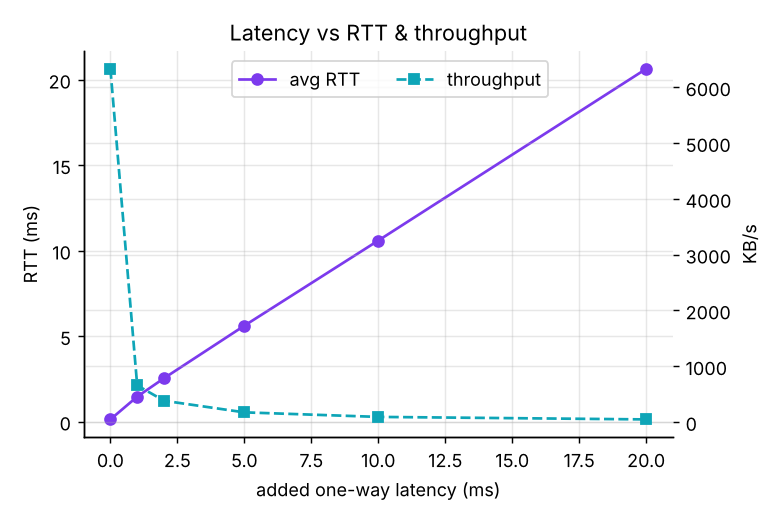
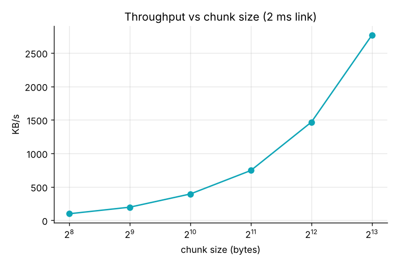

# Performance results

128 KB random file, averaged over 3 runs, emulated link delay 2.0 ms (unless stated). Generated by `bench.py`.

## 1. Error control: CRC + retransmit vs Hamming FEC

| error_rate_pct | scheme | throughput_kbps | retransmits | corrected | overhead_pct | verified_pct |
|---|---|---|---|---|---|---|
| 0 | CRC+ARQ | 391.923 | 0 | 0 | 1.79 | 100.0 |
| 0 | Hamming FEC | 387.917 | 0 | 0 | 101.91 | 100.0 |
| 5 | CRC+ARQ | 376.127 | 5.667 | 0 | 6.293 | 100.0 |
| 5 | Hamming FEC | 379.14 | 0 | 8.67 | 101.91 | 100.0 |
| 10 | CRC+ARQ | 354.19 | 14 | 0 | 12.91 | 100.0 |
| 10 | Hamming FEC | 386.42 | 0 | 15 | 101.91 | 100.0 |
| 20 | CRC+ARQ | 311.367 | 32.667 | 0 | 27.733 | 100.0 |
| 20 | Hamming FEC | 373.62 | 0 | 28.33 | 101.91 | 100.0 |
| 30 | CRC+ARQ | 262.71 | 60.667 | 0 | 49.973 | 100.0 |
| 30 | Hamming FEC | 378.37 | 0 | 41.67 | 101.91 | 100.0 |
| 40 | CRC+ARQ | 235.46 | 80.333 | 0 | 65.593 | 100.0 |
| 40 | Hamming FEC | 375.13 | 0 | 51.67 | 101.91 | 100.0 |
| 50 | CRC+ARQ | 194.297 | 128 | 0 | 103.45 | 100.0 |
| 50 | Hamming FEC | 375.107 | 0 | 68 | 101.91 | 100.0 |

## 2. Latency

| added_latency_ms | avg_rtt_ms | jitter_ms | throughput_kbps | elapsed_s |
|---|---|---|---|---|
| 0 | 0.131 | 0.02 | 6331.16 | 0.02 |
| 1 | 1.462 | 0.128 | 658.337 | 0.195 |
| 2 | 2.539 | 0.184 | 382.367 | 0.335 |
| 5 | 5.613 | 0.179 | 174.167 | 0.735 |
| 10 | 10.595 | 0.139 | 92.623 | 1.382 |
| 20 | 20.639 | 0.171 | 47.62 | 2.688 |

## 3. Chunk size

| chunk_size_B | throughput_kbps | avg_rtt_ms | overhead_pct |
|---|---|---|---|
| 256 | 98.337 | 2.506 | 6.77 |
| 512 | 196.397 | 2.498 | 3.45 |
| 1024 | 393.51 | 2.468 | 1.79 |
| 2048 | 744.553 | 2.556 | 0.96 |
| 4096 | 1466.713 | 2.495 | 0.55 |
| 8192 | 2765.86 | 2.458 | 0.34 |

## 4. Man-in-the-middle attack (20% of chunks forged, CRC recomputed)

| protection | verified_pct | hmac_fail | retransmits | throughput_kbps |
|---|---|---|---|---|
| CRC32 only | 0.0 | 0 | 0 | 8170.86 |
| CRC32 + HMAC-SHA256 | 100.0 | 32 | 32 | 5241.77 |

`verified_pct` = runs where the received file's SHA-256 matched the original.
