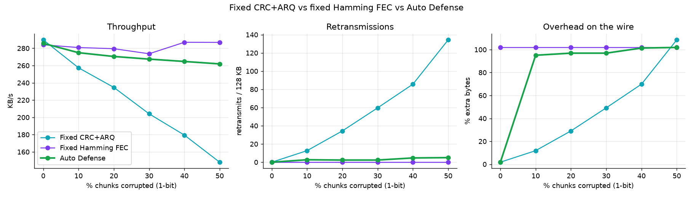
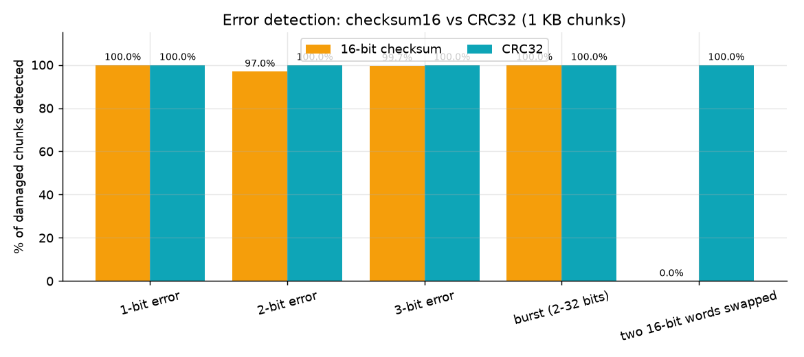
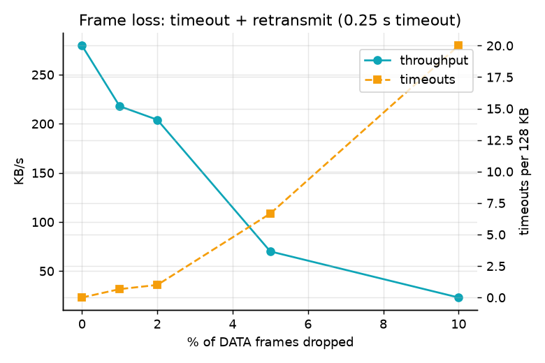

# Performance results

128 KB random file, averaged over 3 runs, emulated link delay 2.0 ms (unless stated). Generated by `bench.py`.

## 1. Error control: CRC + retransmit vs Hamming FEC

| error_rate_pct | scheme | throughput_kbps | retransmits | corrected | overhead_pct | verified_pct |
|---|---|---|---|---|---|---|
| 0 | CRC+ARQ | 287.213 | 0 | 0 | 1.81 | 100.0 |
| 0 | Hamming FEC | 280.02 | 0 | 0 | 101.94 | 100.0 |
| 5 | CRC+ARQ | 281.733 | 5.667 | 0 | 6.303 | 100.0 |
| 5 | Hamming FEC | 283.777 | 0 | 8.67 | 101.94 | 100.0 |
| 10 | CRC+ARQ | 259.203 | 14 | 0 | 12.923 | 100.0 |
| 10 | Hamming FEC | 286.663 | 0 | 15 | 101.94 | 100.0 |
| 20 | CRC+ARQ | 236.28 | 32.667 | 0 | 27.753 | 100.0 |
| 20 | Hamming FEC | 279.81 | 0 | 28.33 | 101.94 | 100.0 |
| 30 | CRC+ARQ | 203.537 | 60.667 | 0 | 49.99 | 100.0 |
| 30 | Hamming FEC | 280.87 | 0 | 41.67 | 101.94 | 100.0 |
| 40 | CRC+ARQ | 186.583 | 80.333 | 0 | 65.607 | 100.0 |
| 40 | Hamming FEC | 278.673 | 0 | 51.67 | 101.94 | 100.0 |
| 50 | CRC+ARQ | 151.303 | 128 | 0 | 103.463 | 100.0 |
| 50 | Hamming FEC | 277.5 | 0 | 68 | 101.94 | 100.0 |

## 2. Latency

| added_latency_ms | avg_rtt_ms | jitter_ms | throughput_kbps | elapsed_s |
|---|---|---|---|---|
| 0 | 0.526 | 0.08 | 1116.123 | 0.117 |
| 1 | 1.958 | 0.185 | 422.57 | 0.303 |
| 2 | 3.099 | 0.341 | 286.077 | 0.449 |
| 5 | 6.189 | 0.211 | 149.98 | 0.854 |
| 10 | 11.285 | 0.271 | 84.467 | 1.515 |
| 20 | 21.265 | 0.209 | 45.513 | 2.813 |

## 3. Chunk size

| chunk_size_B | throughput_kbps | avg_rtt_ms | overhead_pct |
|---|---|---|---|
| 256 | 79.577 | 2.995 | 6.78 |
| 512 | 150.907 | 3.043 | 3.46 |
| 1024 | 293.997 | 2.993 | 1.81 |
| 2048 | 522.857 | 2.959 | 0.97 |
| 4096 | 924.07 | 3.045 | 0.56 |
| 8192 | 1325.917 | 3.134 | 0.35 |

## 4. Man-in-the-middle attack (20% of chunks forged, CRC recomputed)

| protection | verified_pct | hmac_fail | retransmits | throughput_kbps |
|---|---|---|---|---|
| CRC32 only | 0.0 | 0 | 0 | 1128.283 |
| CRC32 + HMAC-SHA256 | 100.0 | 32 | 32 | 960.067 |

`verified_pct` = runs where the received file's SHA-256 matched the original.

## 5. Auto Defense vs fixed protection

Same 128 KB file and 2 ms link. *Fixed CRC+ARQ* resends every damaged chunk, *Fixed Hamming FEC* always pays +100 % bytes, *Auto Defense* starts with CRC+ARQ and enables/disables Hamming by itself (`adaptive.py`). The last block is a link that is 30 % noisy for the first half of the transfer and clean afterwards — the case the closed loop is built for.

| scenario | scheme | throughput_kbps | retransmits | overhead_pct | corrected | verified_pct |
|---|---|---|---|---|---|---|
| 0% errors | Fixed CRC+ARQ | 289.773 | 0 | 1.81 | 0 | 100.0 |
| 0% errors | Fixed Hamming FEC | 284.067 | 0 | 101.94 | 0 | 100.0 |
| 0% errors | Auto Defense | 285.72 | 0 | 1.81 | 0 | 100.0 |
| 10% errors | Fixed CRC+ARQ | 257.407 | 12.667 | 11.863 | 0 | 100.0 |
| 10% errors | Fixed Hamming FEC | 280.86 | 0 | 101.94 | 13.67 | 100.0 |
| 10% errors | Auto Defense | 274.89 | 2.667 | 95.067 | 15.33 | 100.0 |
| 20% errors | Fixed CRC+ARQ | 234.717 | 34.333 | 29.07 | 0 | 100.0 |
| 20% errors | Fixed Hamming FEC | 279.533 | 0 | 101.94 | 26 | 100.0 |
| 20% errors | Auto Defense | 270.527 | 2.333 | 96.887 | 25.33 | 100.0 |
| 30% errors | Fixed CRC+ARQ | 204.127 | 59.667 | 49.193 | 0 | 100.0 |
| 30% errors | Fixed Hamming FEC | 273.657 | 0 | 101.94 | 35.67 | 100.0 |
| 30% errors | Auto Defense | 267.463 | 2.333 | 96.887 | 37 | 100.0 |
| 40% errors | Fixed CRC+ARQ | 179.477 | 85.667 | 69.84 | 0 | 100.0 |
| 40% errors | Fixed Hamming FEC | 286.947 | 0 | 101.94 | 49.33 | 100.0 |
| 40% errors | Auto Defense | 264.747 | 4.667 | 101.347 | 45 | 100.0 |
| 50% errors | Fixed CRC+ARQ | 148.08 | 134.333 | 108.493 | 0 | 100.0 |
| 50% errors | Fixed Hamming FEC | 286.827 | 0 | 101.94 | 63 | 100.0 |
| 50% errors | Auto Defense | 261.89 | 5 | 101.873 | 62 | 100.0 |
| 30% then clean | Fixed CRC+ARQ | 241.09 | 23.667 | 20.6 | 0 | 100.0 |
| 30% then clean | Fixed Hamming FEC | 280.013 | 0 | 101.94 | 24.33 | 100.0 |
| 30% then clean | Auto Defense | 262.693 | 2 | 66.673 | 15.67 | 100.0 |

## 6. Error-detection power: 16-bit checksum vs CRC32

Up to 20000 random 1 KB chunks per pattern (seeded), damage applied, detection = the check value changed. Generated by `bench.py` (`detection_experiment`).

| error_pattern | trials | checksum16_pct | crc32_pct |
|---|---|---|---|
| 1-bit error | 20000 | 100.0 | 100.0 |
| 2-bit error | 20000 | 97.005 | 100.0 |
| 3-bit error | 20000 | 99.665 | 100.0 |
| burst (2-32 bits) | 20000 | 100.0 | 100.0 |
| two 16-bit words swapped | 20000 | 0.0 | 100.0 |

## 7. Frame loss

The proxy silently drops a fraction of DATA frames; the client's ACK timeout (0.25 s here) fires and the chunk is re-sent. Every run still ends verified — each loss costs one timeout.

| frame_loss_pct | throughput_kbps | timeouts | retransmits | elapsed_s | verified_pct |
|---|---|---|---|---|---|
| 0 | 279.573 | 0 | 0 | 0.458 | 100.0 |
| 1 | 217.877 | 0.667 | 0.667 | 0.615 | 100.0 |
| 2 | 204.087 | 1 | 1 | 0.7 | 100.0 |
| 5 | 70.017 | 6.667 | 6.667 | 2.16 | 100.0 |
| 10 | 23.073 | 20 | 20 | 5.625 | 100.0 |
